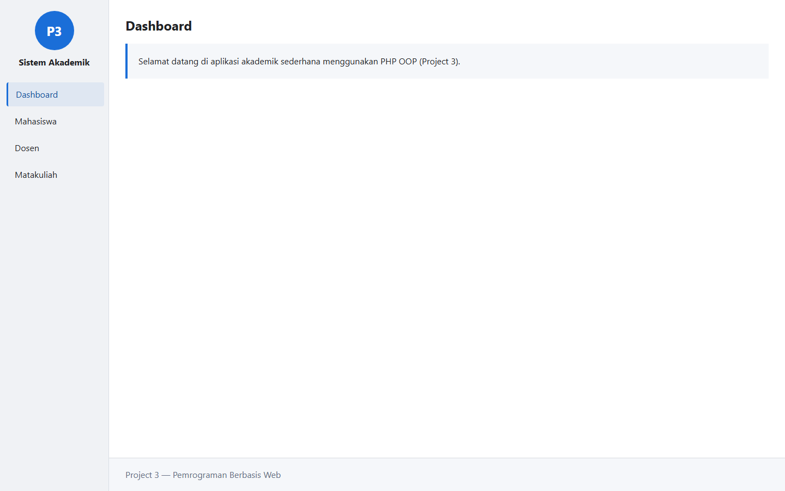
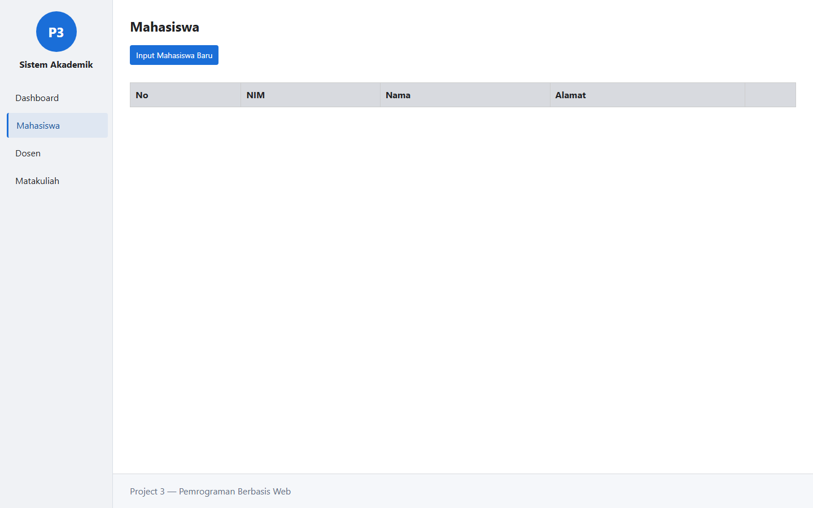
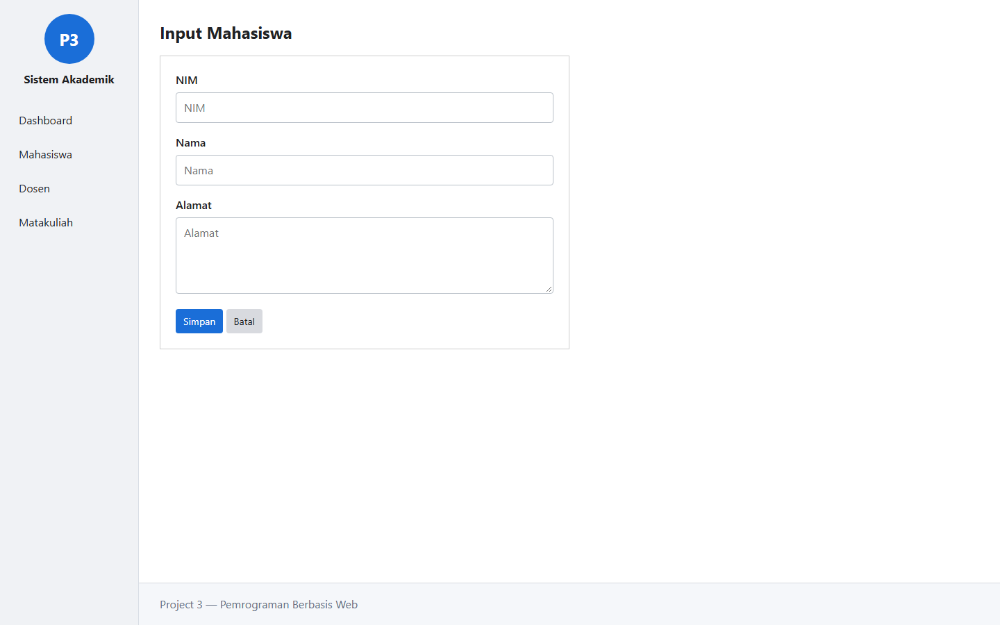
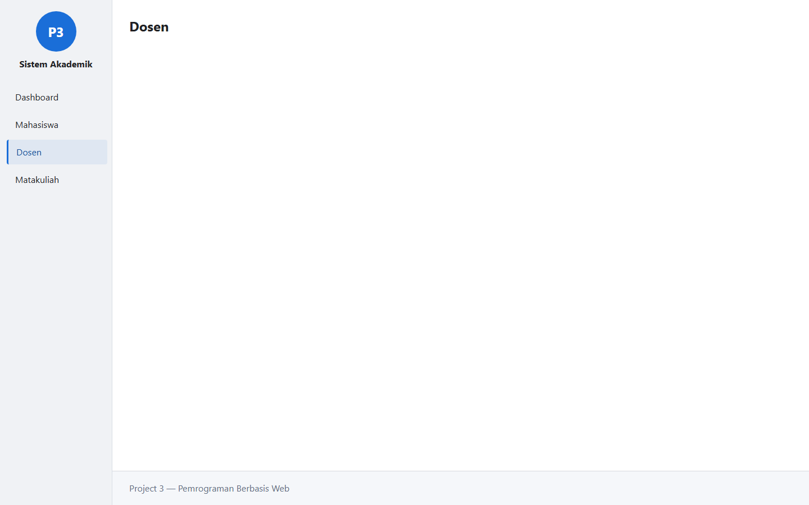
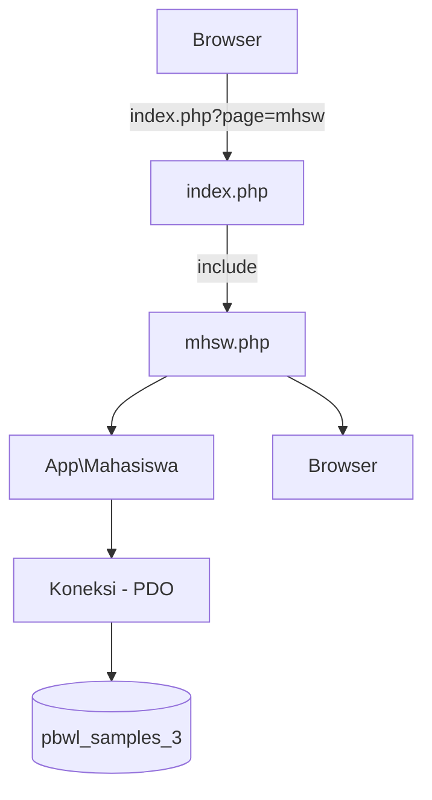

<div align="center">

# 🎓 Sistem Akademik Project 3

**Project 3 · Pemrograman Berbasis Web Lanjutan**

Aplikasi **Sistem Akademik** berbasis **PHP OOP** tanpa framework, dengan CRUD Mahasiswa serta halaman Dosen dan Matakuliah.

     

</div>

## 📖 Deskripsi

Menggunakan **namespace** `App\` dan `Inc\` sehingga class tidak saling tabrakan. Alurnya sengaja dibuat polos agar alur OOP + PDO terlihat jelas: `index.php` menerima parameter `?page=`, lalu menyertakan file halaman yang bersangkutan, yang memanggil class model.

## 📸 Tampilan

<table>
 <tr>
 <td width="50%"><br><sub>Dashboard</sub></td>
 <td width="50%"><br><sub>Daftar Mahasiswa</sub></td>
 </tr>
 <tr>
 <td width="50%"><br><sub>Form Input Mahasiswa</sub></td>
 <td width="50%"><br><sub>Daftar Dosen</sub></td>
 </tr>
</table>

## ✨ Fitur

- 📋 Daftar mahasiswa dari tabel `tb_mhsw`
- ➕ Tambah mahasiswa (NIM, nama, alamat)
- ✏️ Ubah & 🗑️ hapus mahasiswa
- 👨‍🏫 Halaman data dosen (`tb_dosen`)
- 📚 Halaman data matakuliah (`tb_matakuliah`)
- 🔗 Routing sederhana lewat `index.php?page=...`
- 🎨 Tampilan sidebar + tabel rapi (aset CSS lokal)

## 🧱 Teknologi

| Lapisan | Teknologi |
| --- | --- |
| Bahasa | PHP 8.0+ (OOP, tanpa framework) |
| Database | MySQL / MariaDB (PDO) |
| Koneksi | `inc/Koneksi.php` |
| Routing | Query string `?page=` |
| Tampilan | HTML + CSS lokal |

## 🏗️ Arsitektur



## 🚀 Instalasi

1. Pastikan folder ada di `htdocs` XAMPP.
2. Buat database `pbwl_samples_3` lalu import `database.sql`.
3. DSN sudah diarahkan ke `127.0.0.1`, port **3307**, database `pbwl_samples_3`.
4. Buka **http://localhost/pbwl-samples-3/**.

## 🗂️ Struktur

```
pbwl-samples-3/
├── app/
│ ├── Koneksi.php # (project 3: model di app/)
│ └── Mahasiswa.php
├── inc/ # koneksi (project 2 & 3)
├── assets/css/style.css
├── database.sql
├── index.php # router ?page=
├── main.php # dashboard
├── mhsw.php, mhsw_input.php, mhsw_edit.php, mhsw_proses.php
├── dosen.php, matkul.php
└── README.md
```

## 🗄️ Database

Database **`pbwl_samples_3`** di MySQL/MariaDB port **3307** (user `root`, password kosong).

File `database.sql` sudah diimpor. Jika perlu import ulang:

```bash
mysql -h 127.0.0.1 -P 3307 -u root pbwl_samples_3 < database.sql
```

> Database lain di XAMPP (termasuk `dbakademik`) sengaja tidak disentuh.

## ✅ Verifikasi

- `/` → 200
- `/index.php?page=mhsw` → 200
- `/index.php?page=dosen` → 200
- `/index.php?page=matkul` → 200

## 🔗 Tautan

- GitHub: https://github.com/Neuron700/pbwl-samples-3
- Aplikasi: http://localhost/pbwl-samples-3/

## 📄 Lisensi

MIT
